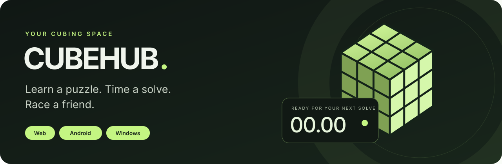
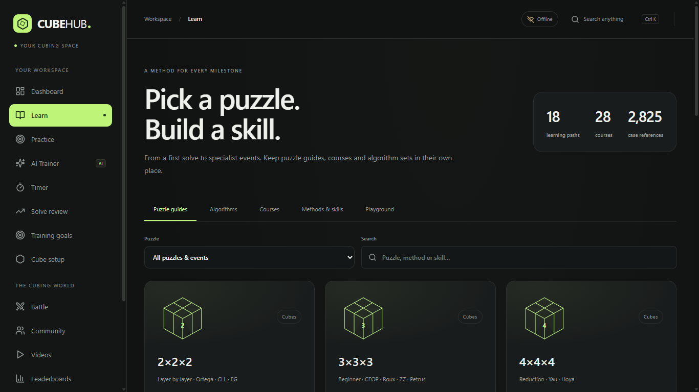
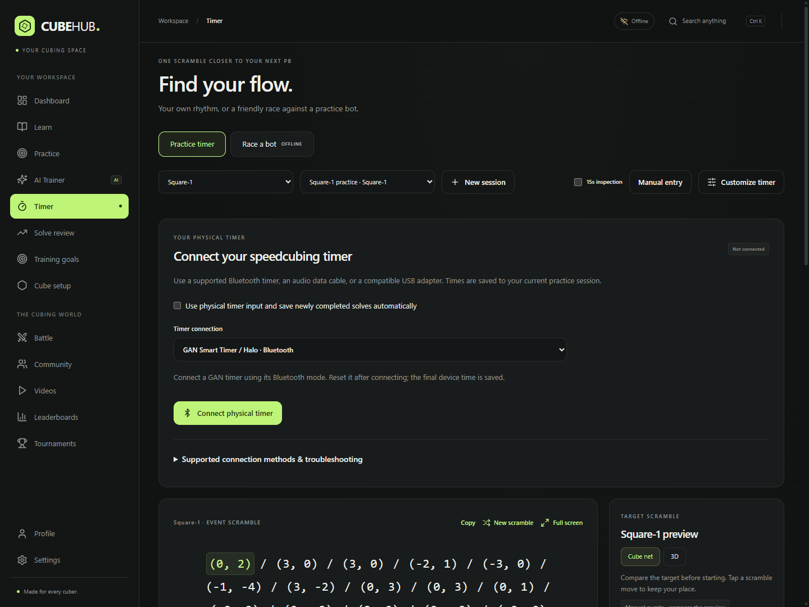
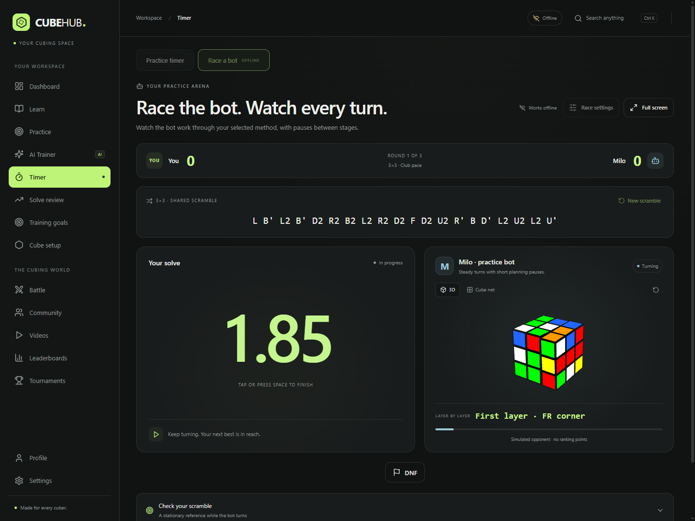
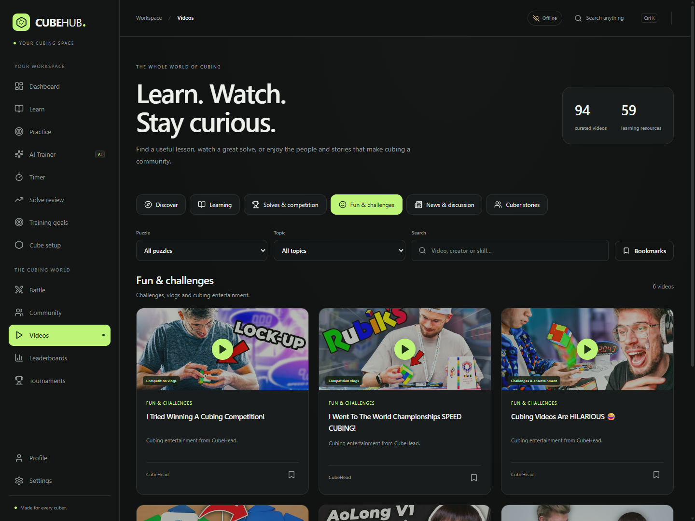

# CubeHub

**Learn a puzzle. Time a solve. Race a friend.**

CubeHub brings practice, learning and friendly competition together on the web, Android and Windows.

[Open the website](https://cubehubs.netlify.app) · [Download page](https://cubehubs.netlify.app/downloads) · [Getting started](docs/getting-started.md) · [Feature guide](docs/learning-and-discovery.md)

## Get CubeHub 0.5.0

| Platform | Download | Best for |
| --- | --- | --- |
| Android | [Android APK](https://github.com/QU73N/cubehub-downloads/releases/download/app-v0.5.0/CubeHub-Android-0.5.0.apk) | Touch timing and practice on your phone |
| Windows | [Windows installer](https://github.com/QU73N/cubehub-downloads/releases/download/app-v0.5.0/CubeHub-Setup-0.5.0.exe) | A desktop shortcut and regular installation |
| Windows portable | [Portable EXE](https://github.com/QU73N/cubehub-downloads/releases/download/app-v0.5.0/CubeHub-Portable-0.5.0.exe) | Opening CubeHub without the installer |
| Web | [Use CubeHub in your browser](https://cubehubs.netlify.app) | Getting started right away |

[Release notes and SHA-256 checksums](https://github.com/QU73N/cubehub-downloads/releases/tag/app-v0.5.0)

These are preview builds. Windows binaries are currently unsigned, and the Android APK uses the existing development signing key. Physical-device compatibility testing is ongoing. An iOS installer is not included.

## A little practice, organized

| Your next step | What CubeHub offers |
| --- | --- |
| Time a solve | 15 event scramblers, a large focus timer, touch/keyboard controls, cube-net and 3D targets, and compact recent history |
| Learn a new puzzle | 18 learning paths, 28 courses and 101 lessons |
| Build a case library | 2,825 algorithm and technique references, separated by puzzle, method and case set |
| Race a bot | Checked CFOP, colour-neutral CFOP, beginner layer-by-layer and 2×2 method steps, with natural pauses and replay |
| Ask a coach | Built-in cubing knowledge, practice plans, and analysis of your saved PBs, averages and available recordings |
| Explore the community | 94 curated learning videos, solves, competitions, entertainment, discussions and cuber interviews |
| Keep practising | Bundled local tools, automatic connection detection, account-bound sync and interrupted-save recovery |

Smart Coach uses rules and a cubing knowledge library, with **no external model calls**. Free accounts get **five answered questions per UTC day**; administrators can grant **unlimited AI Premium**. Unclear questions receive clarification rather than invented answers.

Learning paths cover the WCA events and Mirror blocks. FMC and multi-blind have study paths; ordinary timer results are not presented as their official scores. Source-specific algorithms link to their original notation and diagrams when an accurate local preview is unavailable. See the [feature guide](docs/learning-and-discovery.md) for coverage details.

## Take a look

### Find a puzzle to learn

### Keep the scramble and timer in view

### Watch the bot follow a method

### Learn, compete or unwind

Screenshots use local demonstration data from automated UI checks.

## Local practice and connected features

Installed apps detect when online services are reachable. Active solves and unsaved work delay switching; there is no persistent offline-workspace notification. An empty installation can bind sync after account sign-in. Existing anonymous practice can be linked once in **Settings → Practice sync**.

Human matches, community features, account questions and video streams need a connection. Bot matches are simulated and unranked. Manual timing does not certify solve correctness. Sync uploads and merges local practice; it is not a complete offline mirror of cloud history.

## About this repository

This repository contains public downloads, screenshots and user guides. Application source is maintained separately. New versions are announced through CubeHub's in-app update prompts and this repository's releases.

Algorithm references retain their source links. Videos are embedded from their creators rather than downloaded or rehosted. CubeHub uses the cubing.js and cubecore puzzle libraries for simulation and analysis.
